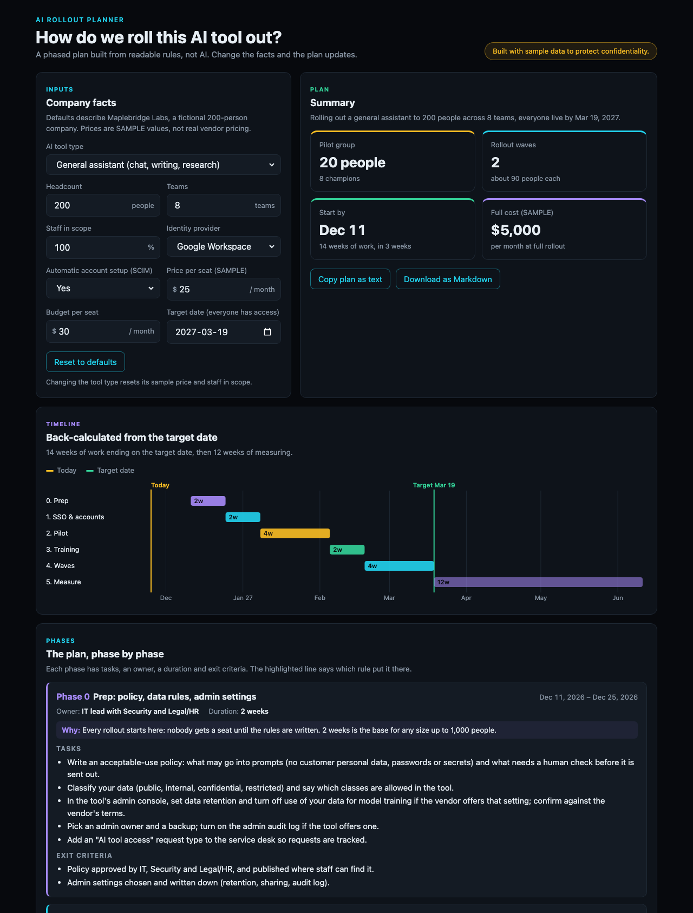

# AI Rollout Planner

> Built with sample data to protect confidentiality. "Maplebridge Labs" is a fictional company, and all seat prices are SAMPLE values, not real vendor pricing.

## Problem
Once a company approves an AI tool, IT gets asked "can everyone have it by March?" Rollouts that skip steps go wrong in predictable ways: nobody wrote down what data may go into prompts, leavers keep their seats because accounts were created by hand, and half the licences sit unused because people were given access without training. IT needs a plan it can defend, sized to the company, before the first seat is switched on.

## What it plans
Pick the AI tool type (general assistant, coding assistant, or meeting/notes assistant) and enter the company facts: headcount, teams, identity provider, whether automatic account setup (SCIM) is available, price and budget per seat, and the target date. The page produces:

- **Six phases**, each with tasks, an owner, a duration and exit criteria:
  0. Prep: policy, data rules, admin settings
  1. Single sign-on and automatic account setup
  2. Pilot group, sized from headcount, with champions per team
  3. Training
  4. Wider rollout in waves
  5. Measure
- **A timeline** back-calculated from the target date, with a warning and the earliest realistic date if the target is too soon.
- **A cost estimate**: seats × price × months, for the pilot, the rollout waves and the first full year, checked against the budget.
- **Success metrics** using the same definitions as the [AI Value Tracker](https://sr-tech-hub.github.io/ai-value-tracker/) (utilization = active ÷ paid seats, hours saved, ROI), which is where you measure them once the tool is live.
- **Export**: copy the plan as text, or download it as Markdown, ready to paste into a ticket or doc.

## Example plan
With the defaults (a general assistant for a 200-person company in 8 teams, Google Workspace with SCIM, $25 SAMPLE price, $30 budget per seat):

- **14 weeks of work** from start to "everyone has access": 2 weeks prep, 2 weeks single sign-on and automatic accounts, a 4-week pilot, 2 weeks training, then 2 rollout waves over 4 weeks. Measuring runs for 12 weeks after.
- **Pilot of 20 people** (10% of 200, at least 2 per team) with **8 champions**, one per team.
- **2 waves of about 90 people**, 4 teams per wave.
- **Cost:** $1,000 for the pilot and training, $2,750 during the waves, then $5,000 a month at full rollout: **$63,750 in the first year**, within budget with $1,000 a month of headroom.
- **Break-even:** at $25 a seat and $50/hour, each active seat pays for itself at about 30 minutes saved a month.

Change the inputs and the plan changes with them. Switching the identity provider to "None" turns Phase 1 into manual invites with a leaver checklist and raises an offboarding risk; 1,200 people gives a 50-person pilot and 4 larger waves; a target date that is too soon shows how many weeks late the plan would be. (Dates in the screenshot depend on the day you open it, because the default target is 16 weeks from today.)

## How it works
1. All the rules sit in one `CONFIG` object at the top of the script in `index.html`: pilot share and limits, champions per team, wave size, phase durations, metric targets and the SAMPLE prices.
2. One function, `buildPlan(inputs)`, turns the inputs into the whole plan. Every panel, the timeline and the Markdown export read from its result, so they always agree.
3. Each phase shows a "Why" line naming the rule that shaped it (for example, "Pilot is 10% of 200 people in scope, at least 2 per team and between 10 and 50 people"). The plan comes from fixed rules, not AI, so a manager can check every step.
4. Steps are kept generic ("enable SAML single sign-on in the tool's admin console") so the plan works for any vendor.

## How to run it
1. Open the live demo (link below), or download/clone this repository.
2. To run it locally, double-click `index.html`, or start a small web server in the project folder with `python3 -m http.server` and open http://localhost:8000. There is no data file to load, so both work.

Live demo: https://sr-tech-hub.github.io/ai-rollout-planner/

## Part of a set
Three small tools covering the life of an AI tool at a company:
- **[AI Tool Risk Triage](https://sr-tech-hub.github.io/ai-tool-risk-triage/)** ([code](https://github.com/sr-tech-hub/ai-tool-risk-triage)): should we approve it?
- **AI Rollout Planner** (this one): how do we roll it out?
- **[AI Value Tracker](https://sr-tech-hub.github.io/ai-value-tracker/)** ([code](https://github.com/sr-tech-hub/ai-value-tracker)): is it paying off?

## Built with
HTML, CSS and JavaScript (single page, no build step, no libraries; the timeline is plain SVG), developed with Claude Code.
